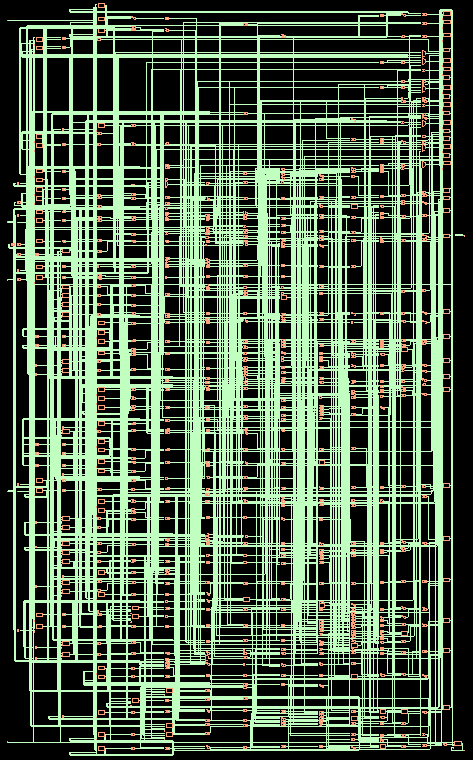
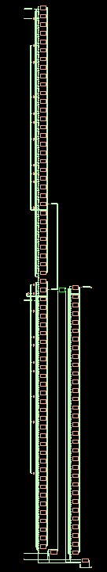
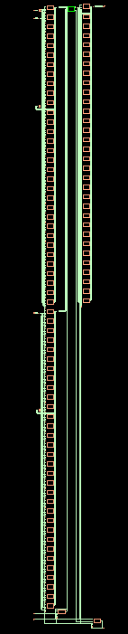
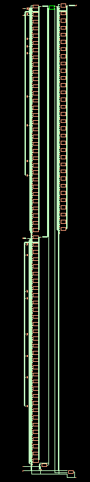

# High-Performance 32-bit VLSI Adders: RTL Design & Verification


## 📌 Project Overview
This repository focuses on the architectural exploration and RTL implementation of high-performance 32-bit parallel adders. In modern microprocessors and ALUs, the ripple-carry effect is a major critical-path bottleneck. This project implements advanced Parallel Prefix Networks (PPN) to solve this limitation by computing Generate ($G$) and Propagate ($P$) signals in parallel.

To guarantee silicon-level reliability and mathematical correctness of these complex architectures, the hardware implementations are rigorously validated using an industry-standard **Universal Verification Methodology (UVM)** environment built from scratch.

---

## Architectural Topologies
The adders implemented in this project map the carry computation into tree-like prefix networks, each offering distinct trade-offs between logic depth, fan-out, and wire routing area.

### 1. Kogge-Stone Adder (32-bit)
**Characteristics:** A radix-2 parallel prefix network. It achieves the maximum theoretical speed with minimum logic depth ($\log_2 N$). However, it suffers from massive wire routing congestion and high fan-out, making it suitable for unconstrained high-performance ALUs where speed is the absolute priority.



### 2. Brent-Kung Adder (32-bit)
**Characteristics:** Utilizes a forward tree to calculate intermediate carries and a reverse tree to compute the rest. It significantly reduces wiring complexity and silicon area compared to Kogge-Stone, at the cost of increased logic depth ($2\log_2 N - 1$) and slightly higher latency.



### 3. Carry-Lookahead Adder (CLA - 32-bit)
**Characteristics:** Computes block carries in parallel rather than fully expanding the prefix tree. It offers a balanced, structured intermediate trade-off between the slow Ripple-Carry and the area-hungry Kogge-Stone.



### 4. CLA Cascade (4x8-bit / Block Format)
**Characteristics:** A variation of the standard CLA where the 32-bit adder is broken down into smaller cascaded blocks. This approach is highly modular and optimizes local routing, often used when layout constraints restrict massive parallel prefix networks.



---

The visual routing congestion observed in the synthesized schematics above directly reflects the mathematical complexity of each prefix network. To summarize these fundamental trade-offs, the table below compares the theoretical logic depth and expected silicon area for each implemented architecture

| Topology | Logic Levels | Routing / Area |
| :--- | :---: | :---: |
| **Kogge-Stone** | $\log_2 N$ | High |
| **Brent-Kung** | $2\log_2 N - 1$ | Low |
| **Carry-Lookahead (CLA)** | Variable | Medium |

---

## Validation Methodology (UVM)
To prove the functional correctness of the implemented RTL architectures, a robust Object-Oriented testbench was developed, moving beyond legacy procedural `$display` tests.

1.  **Golden Reference Model:** The `adder_scoreboard` compares the Design Under Test (DUT) outputs against a purely behavioral SystemVerilog mathematical model on a cycle-by-cycle basis.
2.  **Constrained Random Verification (CRV):** The UVM Sequencer injects randomized transactions, targeting specific corner cases (e.g., $Max + Max$, $0 + 0$, walking-ones, and carry-in toggles).
3.  **SystemVerilog Assertions (SVA):** Concurrent assertions guarantee that hardware inputs and outputs never fall into unknown (`X`) or high-impedance (`Z`) states during active cycles.
4.  **Coverage-Driven Verification (CDV):** Functional coverage is collected to mathematically prove that all critical design corners were stimulated during simulation.

---

## 📂 Repository Structure

```text
├── docs/                    # Architectural diagrams and UVM topology
├── rtl/                     # Synthesizable RTL Designs (Verilog)
│   ├── adder_32bit.v        # Behavioral Reference Model
│   ├── brent_kung_adder32.v
│   ├── carry_look_ahead32.v
│   ├── cla_cascade432.v
│   └── kogge_stone_adder32.v
├── sim/                     # Automation and Simulation scripts
│   ├── Makefile             
│   └── run_sim.sh           
├── tb/                      # Verification Environment (SystemVerilog)
│   ├── legacy/              # Old procedural testbenches
│   ├── uvm_components/      # UVM classes (Agent, Env, Scoreboard, etc.)
│   │   ├── adder_pkg.sv     
│   │   └── adder_if.sv      # Bus Interface with SVA
│   └── tests/               # Top-level testbench
│       └── tb_top.sv
└── README.md
```
----

## How to Run the Simulation

This environment is fully configured to run with **Cadence Xcelium** (``xrun``).

**Option 1: Using Make**

Navigate to the `sim/` directory and run the default batch simulation:

```text
cd sim
make run
```

To run the simulation and open the GUI (SimVision) for waveform inspection:

```text
make gui
```

**Option 2: Using the Bash Script**

You can pass the seed and test name as arguments:

```text
./run_sim.sh adder_test random
```

Note: For those without Cadence licenses, the code is fully compatible with **[EDA Playground](https://www.edaplayground.com)** using Aldec Riviera-PRO or Xcelium (institutional e-mail required).

---

## Verification Results & Coverage

- Functional Coverage: Achieved 100% coverage on all targeted corner cases (0+0, Max+Max, Carry-in toggles, etc.).

- Scoreboard Status: `0 Mismatches` across 10k + randomized transactions.

[Screenshot of the terminal showing the UVM MATCH logs or the Cadence IMC coverage report here!]

---

## 📚 References

The architectural designs and theoretical concepts implemented in this repository are based on the standard literature for VLSI design and computer arithmetic:

- Parhami, B. (2010). Computer Arithmetic: Algorithms and Hardware Designs (2nd ed.). Oxford University Press.

- Weste, N. H. E., & Harris, D. M. (2010). CMOS VLSI Design: A Circuits and Systems Perspective (4th ed.). Addison-Wesley.

